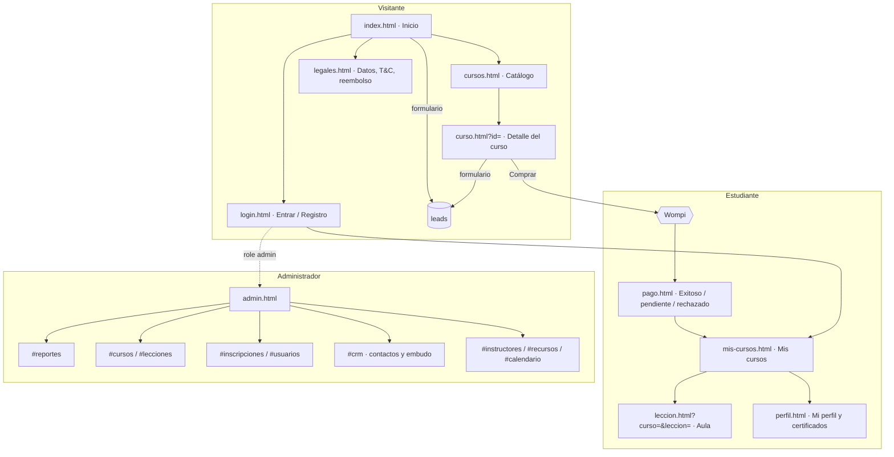

# Mapa del sitio · 13 pantallas

| # | Pantalla | Archivo | Quién | Sprint |
|---|----------|---------|-------|--------|
| 1 | Inicio (landing) | `index.html` | Visitante | 1 |
| 2 | Catálogo | `cursos.html` | Visitante | 1 |
| 3 | Detalle del curso | `curso.html?id=` | Visitante | 1 y 4 |
| 4 | Registro e inicio de sesión | `login.html` | Visitante | 2 |
| 5 | Pago y confirmación | `pago.html` | Estudiante | 4 |
| 6 | Mis cursos | `mis-cursos.html` | Estudiante | 3 |
| 7 | Lección (aula) | `leccion.html` | Estudiante | 3 |
| 8 | Mi perfil | `perfil.html` | Estudiante | 3 |
| 9 | Administrar cursos y lecciones | `admin.html#cursos` · `#lecciones` | Admin | 3 |
| 10 | CRM: contactos y embudo | `admin.html#crm` | Admin | 4 |
| 11 | Recursos | `admin.html#instructores` · `#recursos` · `#calendario` | Admin | 5 |
| 12 | Reportes | `admin.html#reportes` | Admin | 5 |
| 13 | Legales | `legales.html` | Visitante | 5 |

Navegación común: el header (`js/app.js`) cambia según la sesión: **Entrar** → **Mis cursos · Hola, nombre · Salir** (+ **Admin** si `role: admin`). El footer enlaza catálogo, cuenta, contacto y legales.
